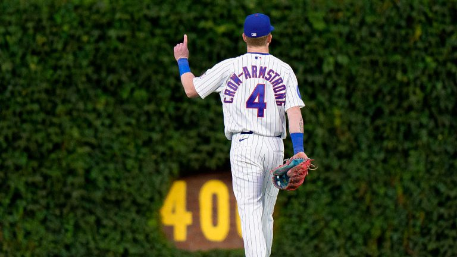
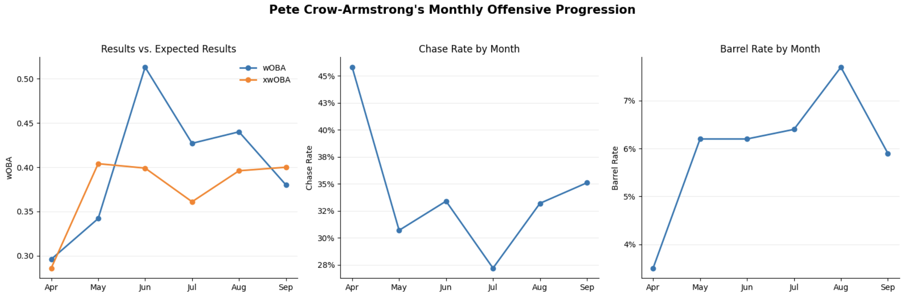
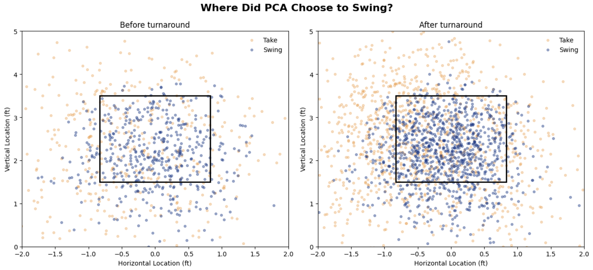
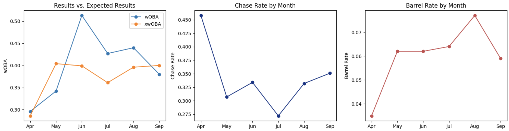

{fig-alt="Pete Crow-Armstrong of the Chicago Cubs" fig-align="center" width="100%"}

<small>CHICAGO, ILLINOIS – JUNE 16: Pete Crow-Armstrong #4 of the Chicago Cubs points toward the field during a matchup against the Colorado Rockies at Wrigley Field on June 16, 2026, in Chicago, Illinois. Photo by Matt Dirksen/Chicago Cubs/Getty Images.</small>

## From a Slow Start to an MVP Season

Pete Crow-Armstrong had a season most baseball players can only dream of.

In 2026, the Chicago Cubs center fielder hit **45 home runs, stole 41 bases, drove in 107 runs, and posted a .280/.372/.570 slash line**. He became just the seventh player in Major League Baseball history to join the coveted 40/40 club, his 10.6 fWAR led all of baseball, and the historic campaign earned him a unanimous National League Most Valuable Player award.

But just a few months earlier, many Cubs fans were calling for Crow-Armstrong to be benched due to his inconsistency at the plate. His aggressive approach left him vulnerable to pitches outside the strike zone, and his existing swing mechanics weren't consistently translating his considerable athleticism into productive contact.

Then, something drastic changed.

In May, PCA made a series of adjustments that would fundamentally reshape his season. He narrowed his stance, moved closer to the plate, repositioned his hands, and completely altered his mental approach to his at-bats.

So, how exactly did a hitter who struggled through the opening month of the season become the most valuable player in the National League?

**Well, Joey Ran the Stats.**

Using Python and Statcast pitch-level data, I wanted to investigate two parts of PCA's transformation. The snippets below highlight the key steps; the complete code, including the visualization work, is available on GitHub.

1. **The mental shift:** Did he actually become more selective at the plate, and could that change be quantified?
2. **The mechanical shift:** Did his mechanical adjustments translate into better contact quality?

Rather than simply comparing his statistics at the beginning and end of the season, I wanted to examine the individual pitches that make up those statistics. By looking at his swing decisions, pitch locations, and batted-ball outcomes, we can get a much better understanding of what actually changed, and how sustainable this production is.

## 1. Building the Dataset

Before analyzing anything, I needed the data.

I used the `pybaseball` library to retrieve Statcast data directly from Baseball Savant. Specifically, I pulled every pitch recorded for Crow-Armstrong throughout the 2026 regular season.

The dataset includes information about each pitch, including its location, velocity, outcome, and the resulting batted-ball measurements.

### Retrieving Statcast Data

I started by importing the libraries needed for the analysis and retrieving PCA's pitch-level data using his MLBAM player ID.

```{python}
#| eval: false

from pybaseball import statcast_batter, cache
import pandas as pd

cache.enable()

PCA_ID = 691718
df = statcast_batter("2026-03-20", "2026-10-05", PCA_ID)
df = df[df["game_type"] == "R"].copy()

df["game_date"] = pd.to_datetime(df["game_date"])
df["month"] = df["game_date"].dt.month.clip(lower=4)

```

This returned **2,922 pitches**, covering March 26 through September 27.

I also grouped the late-March games into April so that the monthly comparisons would be easier to interpret.

With the dataset ready, I could start examining the two major components of PCA's transformation.

## 2. The Mental Shift: Becoming a More Selective Hitter

One of the biggest changes in PCA's approach was his ability to recognize which pitches deserved his aggression.

In 2025, his chase rate was 41.7%, meaning he swung at more than four out of every ten pitches outside the strike zone.

That tendency gave pitchers an easy way to attack him. Rather than challenging him directly, they could expand the strike zone and rely on his willingness to chase.

In May 2026, however, his approach began to change. MLB reported that his strikeout rate dropped from 29.7% in March and April to 21.3% in May. His whiff rate also fell from 29.9% to 23.7%.

I wanted to see whether these improvements were reflected in the actual pitches he chose to swing at.

### Defining Swing Decisions

The first step was identifying which pitches resulted in a swing and which resulted in a miss.

Statcast records pitch outcomes through the `description` column. I created two lists to classify these outcomes.

These Boolean columns allowed me to calculate swing and whiff rates directly from the pitch-level data.

For example, the swing rate is simply the percentage of pitches on which PCA swung. Chase rate is the percentage of pitches outside the strike zone on which he swung.

### Finding the Turning Point

I chose May 14 as the dividing point for my before-and-after analysis, because that’s when *Bleed Cubbie Blue* reported that Crow-Armstrong changed his batting stance.

This gave me two samples:

- Before: 641 pitches
- After: 2,281 pitches

I then calculated the swing rate, chase rate, and whiff rate for each period:

```{python}
#| eval: false

SWINGS = [
    "swinging_strike", "swinging_strike_blocked", "foul",
    "foul_tip", "hit_into_play", "foul_bunt", "missed_bunt"
]
WHIFFS = ["swinging_strike", "swinging_strike_blocked", "missed_bunt"]

df["swing"] = df["description"].isin(SWINGS)
df["whiff"] = df["description"].isin(WHIFFS)

turnaround = "2026-05-14"
before = df[df["game_date"] < turnaround]
after = df[df["game_date"] >= turnaround]

for label, sample in [("Before", before), ("After", after)]:
    out_of_zone = sample[sample["zone"] >= 11]

    swing_rate = sample["swing"].mean()
    chase_rate = out_of_zone["swing"].mean()
    whiff_rate = sample["whiff"].sum() / sample["swing"].sum()

    print(label, round(swing_rate, 3), round(chase_rate, 3), round(whiff_rate, 3))
```

The results were particularly interesting.

::: {style="margin: 2rem 0;"}
| Metric | Before | After | Change |
|:--|--:|--:|--:|
| Swing Rate | 54.8% | 48.2% | -6.6 pp |
| Chase Rate | 42.4% | 31.9% | -10.5 pp |
| Whiff Rate | 25.4% | 23.8% | -1.6 pp |
:::

The most important number is his chase rate.

After May 14, PCA chased pitches outside the strike zone just 31.9% of the time, compared with 42.4% beforehand.

But his overall swing rate also declined, which raises an important question: Was he simply becoming more passive?

To answer that, I needed to distinguish between pitches inside and outside the strike zone.

This produced an even more revealing comparison.

::: {style="margin: 2rem 0;"}
| Metric | Before | After |
|:--|--:|--:|
| In-Zone Swing Rate | 70.3% | 68.1% |
| Share of Swings in the Zone | 58.1% | 64.6% |
:::

PCA's in-zone swing rate dipped only slightly, from 70.3% to 68.1%, while the share of his swings that came on strikes rose from 58.1% to 64.6%. 

So, he was still attacking roughly the same proportion of strikes, the only difference was that he was becoming much less willing to chase pitches outside the zone.

In other words, his mental shift hadn't caused him to become a passive hitter, it just made him become a more selective hitter.

### Visualizing His Swing Decisions

Percentages are useful, but they don't necessarily tell the entire story. I also wanted to see where PCA was actually swinging.

Using Statcast's `plate_x` and `plate_z` variables, I plotted the horizontal and vertical locations of every pitch he saw. I separated pitches he swung at from pitches he took, then created two plots to compare the periods.

::: {style="margin: 2.5rem 0; text-align: center;"}
{fig-align="center" width="85%"}

*Figure 1. Pitch locations where Crow-Armstrong swung and took pitches before and after May 14.*
:::

In figure 1, the change is clear. In the left panel, from before May 14, blue swing dots stray well outside the box, especially below the zone and off the edges. In the right panel, the swings pack into the strike zone, and the pitches around it, particularly the ones up and out of the zone, are mostly orange takes.

## 3. The Mechanical Shift: Turning Better Decisions Into Better Contact

While PCA was changing his approach at the plate, he was also making substantial mechanical adjustments.

As reported by *The Wall Street Journal* in September, the overhaul included several changes to his starting position:

- **Narrower stance:** Reduced the distance between his feet from approximately 31.5 inches to 18–19 inches.
- **Box positioning:** Moved closer to the plate and deeper into the batter's box, adopting a more upright stance.
- **Hand position:** Lowered his hands from shoulder level to below his chest, near his belt.
- **Bat angle:** Raised the bat to a more upright position, creating a shorter, more direct path to the ball.
- **Stride and leg kick:** Reintroduced a more deliberate stride and leg kick, which became more pronounced into June.

The adjustments were intended to give him a more controlled starting position and help him consistently get into positions where he could drive the baseball.

But did the changes actually translate into better contact?

I wanted to investigate this using two metrics: exit velocity and barrel rate.

### Measuring Contact Quality

Exit velocity measures how hard a baseball is hit. Barrel rate measures how frequently a hitter produces contact with an especially productive combination of exit velocity and launch angle.

Together, they provide a useful way to examine whether PCA was simply making more contact or actually hitting the ball more effectively.

I started by comparing his batted-ball data before and after May 14. Both metrics use balls in play only, which matches how Baseball Savant reports them.

```{python}
#| eval: false

def balls_in_play(data):
    return data[(data["type"] == "X") & data["launch_speed"].notna()]

for label, sample in [("Before", before), ("After", after)]:
    bip = balls_in_play(sample)
    barrels = (bip["launch_speed_angle"] == 6).sum()

    print(label, len(bip), round(bip["launch_speed"].mean(), 2), barrels, round(barrels / len(bip), 3))
```

The results:

::: {style="margin: 2rem 0;"}
| Metric | Before | After | Change |
|:--|--:|--:|--:|
| Average Exit Velocity | 88.88 mph | 90.15 mph | +1.27 mph |
| Barrel Rate | 8.0% | 15.2% | +7.2 pp |
:::

The increase in average exit velocity was relatively modest, but the improvement in barrel rate was more substantial.

This suggests that PCA wasn't necessarily hitting the ball dramatically harder. Instead, he was producing a greater proportion of high-quality contact.

To visualize the distribution of his exit velocities, I created a violin plot comparing the two periods.

::: {style="margin: 2.5rem 0; text-align: center;"}
{fig-align="center" width="85%"}

*Figure 2. Distribution of Crow-Armstrong's exit velocities before and after the turnaround. Black lines indicate means; white lines indicate medians.*
:::

A small increase in average exit velocity usually doesn't mean that a hitter has fundamentally chaned his contact quality. However, when combined with a much higher barrel rate, it provides stronger evidence that PCA was producing more productive contact.

## 4. Tracking the Transformation Month by Month

The before-and-after comparison provides a useful snapshot, but it doesn't capture the entire progression.

I also wanted to understand how PCA's performance evolved throughout the season.

For this, I calculated monthly wOBA, xwOBA, chase rate, whiff rate, average exit velocity, and barrel rate.

### Building the Monthly Metrics

Using the `swing` and `whiff` columns created earlier, I summarized the relevant statistics for each month:

```{python}
#| eval: false

def balls_in_play(d):
    return d[(d["type"] == "X") & d["launch_speed"].notna()]

def summarize(month_data):
    pa = month_data[month_data["woba_denom"] == 1]
    xwoba = pa["estimated_woba_using_speedangle"].fillna(pa["woba_value"])
    out_of_zone = month_data[month_data["zone"] >= 11]
    bip = balls_in_play(month_data)

    return pd.Series({
        "PA": len(pa),
        "wOBA": pa["woba_value"].mean(),
        "xwOBA": xwoba.mean(),
        "chase_rate": out_of_zone["swing"].mean(),
        "whiff_rate": month_data["whiff"].sum() / month_data["swing"].sum(),
        "BIP": len(bip),
        "avg_EV": bip["launch_speed"].mean(),
        "barrel_rate": (bip["launch_speed_angle"] == 6).mean(),
    })

monthly = df.groupby("month").apply(summarize).round(3)

monthly.index = [calendar.month_abbr[m] for m in monthly.index]

monthly
```

The resulting data shows a particularly interesting progression.

::: {style="margin: 2rem 0;"}
| Month | PA | wOBA | xwOBA | Chase Rate | Barrel Rate |
|:--|--:|--:|--:|--:|--:|
| April | 126 | .296 | .286 | 45.8% | 7.6% |
| May | 122 | .342 | .404 | 30.7% | 12.8% |
| June | 123 | .513 | .399 | 33.4% | 12.3% |
| July | 108 | .427 | .361 | 27.2% | 15.3% |
| August | 131 | .440 | .396 | 33.2% | 17.6% |
| September | 107 | .380 | .400 | 35.1% | 14.5% |
:::

::: {style="margin: 2.5rem 0; text-align: center;"}
{fig-align="center" width="85%"}

*Figure 3. Monthly progression of Crow-Armstrong's offensive production and underlying metrics.*
:::

April was clearly the low point. PCA posted a .296 wOBA and chased 45.8% of pitches outside the strike zone.

By May, his chase rate had fallen to 30.7%, while his xwOBA jumped to .404.

June was the offensive explosion. His actual wOBA reached .513, although his xwOBA remained lower at .399. This distinction is important because it shows that actual production and underlying contact quality don't always move together.

July brought his lowest monthly chase rate of the season at 27.2%.

August was particularly interesting from a contact-quality perspective. His barrel rate reached 7.7%, the highest monthly figure in the dataset.

By September, his actual production had cooled, but his .400 xwOBA remained strong.

The overall progression suggests that PCA's transformation was more than a brief hot streak. His approach improved substantially, and his quality of contact remained elevated throughout the summer.

## 5. Putting It All Together

PCA's 2026 season was defined by two complementary adjustments.

First, he refined his approach at the plate. His chase rate declined by 10.5 percentage points after May 14, while his in-zone swing rate remained virtually unchanged. He became more selective about the pitches he attacked, while maintaining his aggression within the strike zone.

Second, he reshaped his swing mechanics. His narrower stance, adjusted hand position, and more deliberate stride gave him a new foundation from which to attack pitches.

The results were reflected in his underlying metrics. His barrel rate increased from 3.9% before the turnaround to 6.6% afterward, while his average exit velocity climbed from 83.62 to 83.97 mph. Together, these changes point to more productive contact.

By the end of September, Crow-Armstrong had accumulated 45 home runs, 41 stolen bases, and 10.6 fWAR. He became the seventh player in MLB history to join the 40/40 club and unanimously won the National League Most Valuable Player award.

His season demonstrated how simple adjustments in approach and mechanics can translate into incredible results at the plate. Crow-Armstrong refined his pitch selection, developed a more productive swing, and put together one of the most remarkable seasons in recent baseball history.

That willingness to adjust may have been what ultimately separated a great season from an MVP season.

---

## Sources & Appendix

### Data & Sources

- [Baseball Savant](https://baseballsavant.mlb.com/) — Statcast pitch-level data
- [Baseball Savant — Pete Crow-Armstrong](https://baseballsavant.mlb.com/savant-player/pete-crow-armstrong-691718) — Player Statcast profile
- [MLB.com — Is PCA back? Why red-hot May could be sign of more good things to come](https://www.mlb.com/news/why-pete-crow-armstrong-s-red-hot-may-is-good-sign) — May performance and approach changes
- [The Wall Street Journal — The Risky Mechanical Overhaul That Built a Baseball MVP](https://www.wsj.com/sports/baseball/pete-crow-armstrong-batting-stance-mvp-cubs-dad7d6d5) — Mechanical adjustments
- [Bleed Cubbie Blue - Pete Crow-Armstrong’s surge could have been created by something very simple](https://www.bleedcubbieblue.com/chicago-cubs-analysis/222774/pete-crow-armstrong-surge-batting-cubs) - Date of mechanical adjustments

### Statistical Definitions

- **Chase Rate:** Percentage of pitches outside the strike zone at which the hitter swings.
- **In-Zone Swing Rate:** Percentage of pitches inside the strike zone at which the hitter swings.
- **Whiff Rate:** Percentage of swings that result in a swing and miss.
- **wOBA:** Weighted On-Base Average, measuring offensive production by assigning different values to different outcomes.
- **xwOBA:** Expected Weighted On-Base Average, estimating offensive production based primarily on quality of contact.
- **Exit Velocity:** Speed of the baseball immediately after contact.
- **Barrel Rate:** Percentage of batted balls classified as barrels by Statcast.

---

*Joey Ran the Stats explores baseball through data, statistics, and analysis. The complete code accompanying this article is available on [GitHub](https://github.com/JoeyZeee/JRTS-1).*
